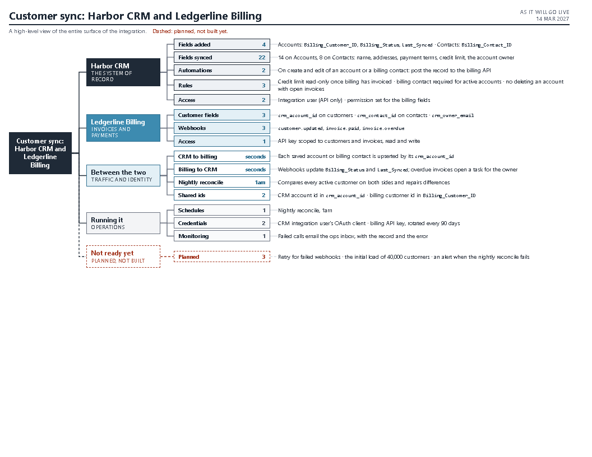

# integration-map

A one-page overview of a software integration as it will run in production. It's a tiered tree:

- the integration;
- each system it lives in, what moves between them, how it's run, and, if you want it, the planned pieces not
  built yet;
- the kinds of piece in each, with real counts;
- the pieces.



## Requirements

- Python 3.8+.
- Chrome, Edge or Chromium for the PDF and PNG. The script runs it headless. Without one you still get
  the HTML, which you can print to PDF yourself.

## Use

Write a JSON spec (see `SKILL.md` and `examples/crm-billing-sync.json`), then:

```
python scripts/render.py spec.json map.pdf --png map.png
```

`SKILL.md` has the method: what goes in each tier, what to leave out (setup scripts, tests and other
build tooling), and how to count the pieces from the source instead of estimating.
